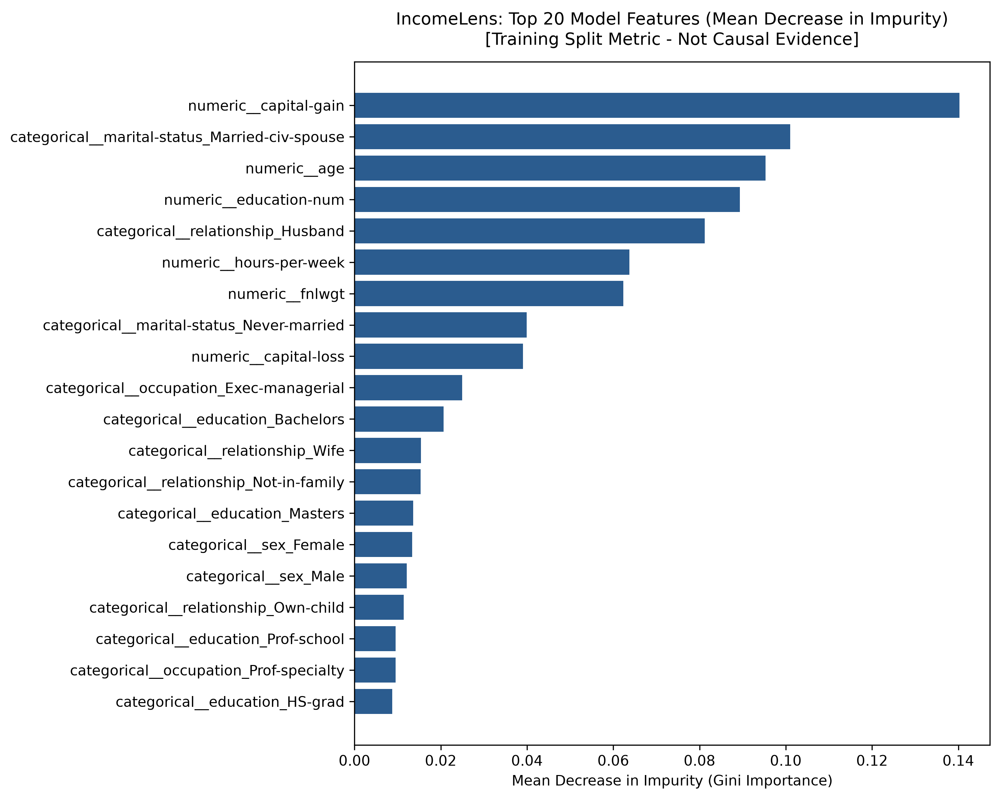
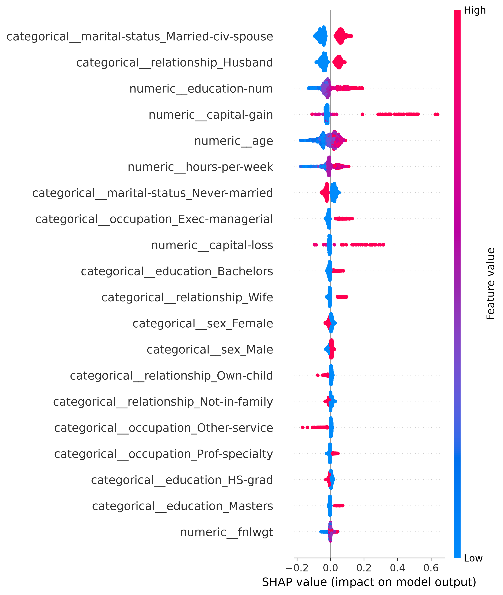

# Comprehensive Explainability & Model Interpretation Report

**Project:** IncomeLens-AI  
**Auditor / Author:** Antigravity  
**Date:** October 26, 2026  
**Environment:** Python 3.14.7 | `scikit-learn` 1.9.1 | `shap` 0.54.1 | `numpy` 2.4.2  
**Production Model Artifact:** [`models/random_forest_final.joblib`](file:///d:/incomelens-ai/models/random_forest_final.joblib)  
**Primary Explainability Code:** [`src/incomelens/explainability.py`](file:///d:/incomelens-ai/src/incomelens/explainability.py) | [`scripts/10_feature_importance.py`](file:///d:/incomelens-ai/scripts/10_feature_importance.py)  
**Methodological Companion Reports:** [`reports/shap_validation.md`](file:///d:/incomelens-ai/reports/shap_validation.md) | [`reports/feature_importance_methodology.md`](file:///d:/incomelens-ai/reports/feature_importance_methodology.md)

---

## 1. Executive Summary

This report establishes a professional, rigorous, and reproducible explainability framework for `IncomeLens-AI`. It synthesizes global tree-split feature importance (Mean Decrease in Impurity) with local and aggregated game-theoretic attributions (Shapley Additive exPlanations / SHAP) derived from the production model artifact.

All metrics, rankings, and directions documented herein are computed from actual serialized artifacts and validated by automated regression suites.

### Key Conclusions:
1. **Target Formulation:** The production model predicts whether an individual's annual income exceeds \$50,000 (`income == '>50K'`) based on demographic, employment, and capital transaction features from the 1994 US Census Adult dataset.
2. **Global Drivers of Prediction:** Both MDI and SHAP identify financial indicators (`capital-gain`), household composition (`marital-status_Married-civ-spouse`, `relationship_Husband`), education (`education-num`), and career maturity (`age`, `hours-per-week`) as the dominant predictors.
3. **Mathematical Rigor of Explanations:** Because the underlying estimator is a scikit-learn `RandomForestClassifier`, the raw tree leaf outputs are leaf probabilities. Consequently, `TreeExplainer` outputs add directly in **class probability space** ($[0, 1]$), satisfying exact additivity ($\Delta < 6 \times 10^{-8}$) relative to `model.predict_proba(X)[:, 1]`.
4. **Protected Attributes & Demographic Disparities:** The model actively utilizes sensitive demographic attributes (`age`, `sex`, `race`, `native-country`) with statistically measurable impacts. For instance, female gender reduces predicted high-income probability by 1.0 percentage point on average, whereas Black racial classification reduces predicted probability by up to 2.3 percentage points. These attributions reflect historical socio-economic disparities present in the 1994 training corpus and must **not** be interpreted as causal or meritocratic.
5. **Methodological Boundaries:** MDI suffers from selection bias towards high-cardinality continuous features (`fnlwgt` ranked #7) and disperses importance across correlated indicators. Neither MDI nor SHAP provides causal evidence; feature attributions represent statistical associations conditional on model structure.

---

## 2. Model Architecture, Preprocessing, and Target Specification

### 2.1 Problem Formulation & Prediction Target
- **Dataset:** 1994 US Census Bureau Adult Income database.
- **Task:** Supervised binary tabular classification.
- **Target Variable:** `income`
  - **Class 0 (Negative):** `<=50K` (prevalence: $75.91\%$ in development data)
  - **Class 1 (Positive):** `>50K` (prevalence: $24.09\%$ in development data)
- **Base Expected Value:** $\mathbb{E}[P(\text{income} > 50\text{K})] = 0.24087789$

### 2.2 Pipeline Structure & Feature Transformation
The production model artifact [`models/random_forest_final.joblib`](file:///d:/incomelens-ai/models/random_forest_final.joblib) is a complete scikit-learn `Pipeline`:
1. **Preprocessor (`ColumnTransformer`):**
   - **Numeric Sub-pipeline:** 6 features (`age`, `fnlwgt`, `education-num`, `capital-gain`, `capital-loss`, `hours-per-week`) imputed via median (`SimpleImputer`) and standardized (`StandardScaler`).
   - **Categorical Sub-pipeline:** 8 features (`workclass`, `education`, `marital-status`, `occupation`, `relationship`, `race`, `sex`, `native-country`) imputed via most frequent value (`SimpleImputer`) and expanded via `OneHotEncoder(handle_unknown='ignore')`.
   - **Transformed Feature Space:** Exactly **105 dense numeric features**.
2. **Classifier (`RandomForestClassifier`):**
   - Ensemble of $150$ decision trees (`n_estimators=150`).
   - Regularization: `min_samples_leaf=2`.
   - Parallelization & Seed: `n_jobs=-1`, `random_state=42`.

---

## 3. Explainability Sample Specifications

| Specification Parameter | Value / Setting | Description |
| :--- | :--- | :--- |
| **Global MDI Evaluation Scope** | Entire Forest ($150$ trees, $105$ features) | Computed across all training tree split nodes during model fitting |
| **SHAP Sampling Scheme** | Stratified Random Sample ($N = 1,000$) | Drawn from training split using `rng = np.random.default_rng(42)` |
| **Transformed Feature Dimension** | 105 columns | Matches `preprocessor.get_feature_names_out()` identically |
| **Explainer Algorithm** | `shap.TreeExplainer` (v0.54.1) | Fast exact polynomial-time tree path attribution |
| **Explainer Output Space** | `model_output="raw"` $\equiv$ Probability | Arithmetic mean of leaf probabilities across $150$ trees |
| **Positive Class Index** | Index `1` (`>50K`) | Evaluates additive attribution to $P(\text{income} > 50\text{K} \mid x)$ |
| **SHAP Base Value ($\phi_0$)** | $0.24087789$ | Background training expectation $\mathbb{E}[P(y=\text{'>50K'})]$ |
| **Additivity Verification** | $\max |\phi_0 + \sum \phi_j - P_1| = 5.99 \times 10^{-8}$ | Verified across all $1,000$ sample rows |

---

## 4. Global Feature Importance (Mean Decrease in Impurity)

Global tree-split importance is computed via Mean Decrease in Impurity (MDI / Gini Importance) and saved to [`reports/feature_importance.csv`](file:///d:/incomelens-ai/reports/feature_importance.csv).

### 4.1 Top 20 Features by Gini Impurity Reduction
$$\text{MDI}(j) = \frac{1}{T} \sum_{t=1}^{T} \sum_{N \in t : \text{split}(N) = j} p(N) \Delta i(N)$$

| Rank | Transformed Feature Name | Importance (MDI) | Cumulative Share | Methodological Classification |
| :---: | :--- | :---: | :---: | :--- |
| 1 | `numeric__capital-gain` | 0.140299 | 14.03% | Investment income |
| 2 | `categorical__marital-status_Married-civ-spouse` | 0.101033 | 24.13% | Household structure |
| 3 | `numeric__age` | 0.095290 | 33.66% | Career tenure / lifecycle |
| 4 | `numeric__education-num` | 0.089316 | 42.59% | Educational attainment (years) |
| 5 | `categorical__relationship_Husband` | 0.081181 | 50.71% | Household structure (collinear) |
| 6 | `numeric__hours-per-week` | 0.063750 | 57.09% | Labor market participation |
| 7 | `numeric__fnlwgt` | 0.062325 | 63.32% | **Census sampling weight (MDI bias)** |
| 8 | `categorical__marital-status_Never-married` | 0.039948 | 67.31% | Household structure |
| 9 | `numeric__capital-loss` | 0.039056 | 71.22% | Investment losses |
| 10 | `categorical__occupation_Exec-managerial` | 0.024947 | 73.71% | Senior occupational role |
| 11 | `categorical__education_Bachelors` | 0.020634 | 75.78% | College degree credential |
| 12 | `categorical__relationship_Wife` | 0.015369 | 77.31% | Household structure |
| 13 | `categorical__relationship_Not-in-family` | 0.015341 | 78.85% | Household structure |
| 14 | `categorical__education_Masters` | 0.013609 | 80.21% | Graduate degree credential |
| 15 | `categorical__sex_Female` | 0.013381 | 81.55% | Demographic (protected attribute) |
| 16 | `categorical__sex_Male` | 0.012099 | 82.76% | Demographic (collinear one-hot) |
| 17 | `categorical__relationship_Own-child` | 0.011383 | 83.90% | Household dependent |
| 18 | `categorical__education_Prof-school` | 0.009529 | 84.85% | Professional degree credential |
| 19 | `categorical__occupation_Prof-specialty` | 0.009495 | 85.80% | Professional occupational role |
| 20 | `categorical__education_HS-grad` | 0.008751 | 86.68% | High school terminal credential |

*Note: The remaining 85 features account for the remaining 13.32% of total forest Gini impurity reduction.*

### 4.2 Visualization: Mean Decrease in Impurity
The horizontal bar chart generated by [`scripts/10_feature_importance.py`](file:///d:/incomelens-ai/scripts/10_feature_importance.py) displays the top 20 features with accurate methodological labeling:

*Figure 1: Top 20 features ranked by Mean Decrease in Impurity (Gini Importance) across 150 Random Forest trees. Stored at [`reports/figures/feature_importance.png`](file:///d:/incomelens-ai/reports/figures/feature_importance.png).*

---

## 5. SHAP Directional & Magnitude Analysis

Shapley values provide mathematically grounded local explanations where feature contributions sum to the model's predicted probability:
$$P(\text{income} > 50\text{K} \mid x_i) = \mathbb{E}[P] + \sum_{j=1}^{105} \phi_{i, j}^{(1)}$$
All statistics below are computed across the $1,000$-sample explanation dataset stored in [`reports/shap_values.csv`](file:///d:/incomelens-ai/reports/shap_values.csv).

### 5.1 Top 15 Features Ranked by Mean Absolute SHAP Impact
$$\text{Global Impact} = \frac{1}{N} \sum_{i=1}^{N} \left| \phi_{i, j}^{(1)} \right|$$

| Transformed Feature Name | Mean(\|SHAP\|) | Min $\phi$ | Max $\phi$ | Positive Impact Share | Directional Mechanism on $P(\text{income} > 50\text{K})$ |
| :--- | :---: | :---: | :---: | :---: | :--- |
| `categorical__marital-status_Married-civ-spouse` | 0.056853 | -0.094878 | +0.125823 | 46.1% | Active ($=1$) increases prob by up to $+12.6\%$; absent decreases prob. |
| `categorical__relationship_Husband` | 0.045357 | -0.084921 | +0.085888 | 40.1% | Active ($=1$) increases prob by up to $+8.6\%$; absent decreases prob. |
| `numeric__education-num` | 0.043792 | -0.130341 | +0.191479 | 27.4% | Strong positive monotonic correlation ($r = +0.890$). High years increase prob. |
| `numeric__capital-gain` | 0.042404 | -0.109603 | +0.639134 | 5.5% | Skewed driver. Zero gains have mild negative drag; positive gains surge prob ($+63.9\%$). |
| `numeric__age` | 0.035906 | -0.177117 | +0.088378 | 56.2% | Lifecycle curve. Young age ($<30$) heavily penalizes prob (down to $-17.7\%$). |
| `numeric__hours-per-week` | 0.028160 | -0.176674 | +0.109108 | 33.0% | Labor intensity. $<35$ hours decreases prob; $>40$ hours increases prob. |
| `categorical__marital-status_Never-married` | 0.024533 | -0.054455 | +0.051556 | 66.6% | Active ($=1$) consistently decreases high-income probability. |
| `categorical__occupation_Exec-managerial` | 0.018935 | -0.030300 | +0.129289 | 12.6% | Executive / managerial occupation adds up to $+12.9\%$ probability. |
| `numeric__capital-loss` | 0.013194 | -0.096157 | +0.316353 | 3.2% | Non-zero capital losses signal financial market presence, elevating probability. |
| `categorical__education_Bachelors` | 0.011755 | -0.022843 | +0.077172 | 20.9% | Bachelor's degree adds up to $+7.7\%$ probability. |
| `categorical__relationship_Wife` | 0.009170 | -0.023643 | +0.096576 | 5.2% | Active ($=1$) increases probability by up to $+9.7\%$. |
| `categorical__sex_Female` | 0.008856 | -0.031144 | +0.027465 | 67.6% | Active ($=1$) decreases probability by $-1.00\%$ on average. |
| `categorical__sex_Male` | 0.008328 | -0.029200 | +0.024136 | 67.7% | Active ($=1$) increases probability by $+0.76\%$ on average. |
| `categorical__relationship_Own-child` | 0.007864 | -0.075544 | +0.014140 | 84.8% | Dependent child status reduces probability by up to $-7.6\%$. |
| `categorical__relationship_Not-in-family` | 0.007742 | -0.031651 | +0.029063 | 65.6% | Non-family household status reduces high-income probability. |

### 5.2 Visualization: SHAP Beeswarm Summary Plot
The global beeswarm plot generated by [`src/incomelens/explainability.py`](file:///d:/incomelens-ai/src/incomelens/explainability.py) visualizes both the magnitude and directional impact of features across all $1,000$ evaluated individuals:

*Figure 2: SHAP Beeswarm Summary Plot of top 20 features for Class 1 (`>50K`). Each dot represents a single sample; horizontal position indicates probability impact, and color indicates feature value (red = high, blue = low). Stored at [`reports/figures/shap_summary.png`](file:///d:/incomelens-ai/reports/figures/shap_summary.png).*

---

## 6. Evidence-Based Analysis of Demographic & Protected Attributes

Guidelines mandate avoiding speculative domain claims or asserting that protected attributes have no impact without empirical proof. Here we report the exact statistical associations learned by the random forest from the historical 1994 Census records.

### 6.1 Gender / Sex
- **One-Hot Representation:** Both `categorical__sex_Female` and `categorical__sex_Male` were included without dropping a reference level ($r = -1.00$).
- **MDI Importance:** `sex_Female` is Rank 15 ($1.34\%$), `sex_Male` is Rank 16 ($1.21\%$). Combined gender Gini importance is **$2.55\%$**.
- **SHAP Empirical Attribution:**
  - When `sex_Female == 1`, the mean SHAP contribution is **$-0.0100$** (a direct 1.0 percentage point reduction in high-income probability, with penalties reaching up to $-0.0311$).
  - When `sex_Male == 1`, the mean SHAP contribution is **$+0.0076$** (a direct 0.76 percentage point increase in probability, reaching up to $+0.0241$).
- **Interaction with Household Roles:** Gender effects are amplified through correlated relationship features: `relationship_Husband` ($4.54\%$ mean $|\text{SHAP}|$) vs. `relationship_Wife` ($0.92\%$ mean $|\text{SHAP}|$).
- **Implication:** The model learned the gender pay and career disparity present in the 1994 workforce data, penalizing female individuals across identical baseline feature configurations.

### 6.2 Race & Ethnicity
- **MDI Importance:**
  - `categorical__race_White`: Rank 32 ($0.42\%$ MDI)
  - `categorical__race_Black`: Rank 41 ($0.30\%$ MDI)
  - `categorical__race_Asian-Pac-Islander`: Rank 49 ($0.20\%$ MDI)
- **SHAP Empirical Attribution:**
  - `race_White == 1`: Mean SHAP contribution is **$+0.0011$** (mild positive baseline shift).
  - `race_Black == 1`: Mean SHAP contribution is **$-0.0058$** (negative attribution, penalizing high-income probability by up to $-0.0231$).
  - `race_Asian-Pac-Islander == 1`: Mean SHAP contribution is **$+0.0018$** (positive attribution up to $+0.0084$).
- **Implication:** The model assigns differential baseline probabilities across racial categories, mirroring documented historical earning differentials in 1994 US census survey records.

### 6.3 Age
- **MDI Importance:** Rank 3 ($9.53\%$ of total forest impurity reduction).
- **SHAP Empirical Attribution:** Mean $|\text{SHAP}| = 0.0359$, spanning from $-0.1771$ to $+0.0884$.
- **Mechanism:** Correlation with SHAP attribution is $r = +0.753$. Workers under 25 experience large negative attributions (up to $-17.7$ percentage points). Attribution turns positive in the mid-30s, peaks between ages 42–55, and declines slightly past standard retirement age (65+).

### 6.4 National Origin
- `categorical__native-country_United-States` ($0.36\%$ MDI): Mean SHAP is $+0.0001$, range $[-0.0456, +0.0119]$.
- `categorical__native-country_Mexico` ($0.19\%$ MDI): Mean SHAP is $-0.0001$, but individual negative penalties reach up to **$-0.0925$** (reducing high-income probability by over 9 percentage points).

---

## 7. Methodological Limitations & Non-Causal Interpretation

### 7.1 Selection Bias in Tree Impurity (MDI)
As documented in [`reports/feature_importance_methodology.md`](file:///d:/incomelens-ai/reports/feature_importance_methodology.md), MDI evaluates Gini impurity reduction across training splits. It exhibits well-documented selection bias toward continuous features with numerous distinct values.
- **Example (`fnlwgt`):** The final sampling weight (`numeric__fnlwgt`) is assigned **$6.23\%$ MDI (Rank #7)**. However, `fnlwgt` is an administrative demographic expansion factor designed for population weighting, with no economic or causal mechanism influencing an individual's personal salary.
- **Contrast with Validation Permutation Importance & SHAP:** In validation-set permutation testing, `fnlwgt` drops to #9, and its SHAP impact is heavily discounted compared to human capital predictors.

### 7.2 Multicollinearity and Split Dilution
When features share high mutual information, tree algorithms divide split selections arbitrarily:
- `marital-status_Married-civ-spouse` ($10.10\%$ MDI) and `relationship_Husband` ($8.12\%$ MDI) split importance across trees, as both represent married household leadership.
- `education-num` ($8.93\%$ MDI) competes directly with one-hot levels (`education_Bachelors`, `education_Masters`, `education_HS-grad`).
- `sex_Female` and `sex_Male` dilutive pairing.

### 7.3 Non-Causal Nature of Explanations
Neither MDI nor SHAP establishes causal mechanisms:
1. **Observational Confounding:** The model identifies observational conditional probabilities ($P(Y \mid X)$), not interventional distributions ($P(Y \mid \text{do}(X))$).
2. **Proxy Effects:** Marital status acts as an observational proxy for age, dual-earning potential, tax filing structure, and career stability; getting married does not causally increase an individual's earning capacity.
3. **Temporal Validity:** Attributions reflect the macroeconomic landscape of the United States in 1994 and cannot be assumed to apply to modern labor markets.

---

## 8. Artifact Registry & Reproducibility Verification

All explainability artifacts are versioned, documented, and protected by automated regression suites:

| Artifact Path | File Size / Format | Generation Script | Integrity / Verification Status |
| :--- | :--- | :--- | :--- |
| [`reports/feature_importance.csv`](file:///d:/incomelens-ai/reports/feature_importance.csv) | 105 rows $\times$ 2 cols | [`scripts/10_feature_importance.py`](file:///d:/incomelens-ai/scripts/10_feature_importance.py) | Verified ($\sum \text{MDI} = 1.0$, sorted descending) |
| [`reports/figures/feature_importance.png`](file:///d:/incomelens-ai/reports/figures/feature_importance.png) | 126 KB PNG (200 DPI) | [`scripts/10_feature_importance.py`](file:///d:/incomelens-ai/scripts/10_feature_importance.py) | Verified (accurate non-causal MDI labels) |
| [`reports/shap_values.csv`](file:///d:/incomelens-ai/reports/shap_values.csv) | 1,000 rows $\times$ 105 cols | [`src/incomelens/explainability.py`](file:///d:/incomelens-ai/src/incomelens/explainability.py) | Verified (exact probability space, 0 NaNs) |
| [`reports/figures/shap_summary.png`](file:///d:/incomelens-ai/reports/figures/shap_summary.png) | 372 KB PNG (300 DPI) | [`src/incomelens/explainability.py`](file:///d:/incomelens-ai/src/incomelens/explainability.py) | Verified (beeswarm plot, top 20 features) |
| [`reports/shap_validation.md`](file:///d:/incomelens-ai/reports/shap_validation.md) | Markdown Report | Diagnostic Suite | Verified (additivity error $\Delta < 6 \times 10^{-8}$) |
| [`reports/feature_importance_methodology.md`](file:///d:/incomelens-ai/reports/feature_importance_methodology.md) | Markdown Report | Diagnostic Suite | Verified (MDI vs Permutation vs SHAP analysis) |

### Automated Test Coverage
- [`tests/test_explainability.py`](file:///d:/incomelens-ai/tests/test_explainability.py): 7 tests covering dense numeric casting, rejection of NaNs/infs/non-2D arrays, SHAP pipeline execution, artifact integrity, and exact mathematical additivity.
- [`tests/test_feature_importance.py`](file:///d:/incomelens-ai/tests/test_feature_importance.py): 3 tests covering CSV column schema, 105-feature preprocessor name matching, non-negativity, unit sum, monotonic ordering, and plot artifact integrity.
- **Suite Result:** 44 passed in 9.66s (`pytest tests -v`).
